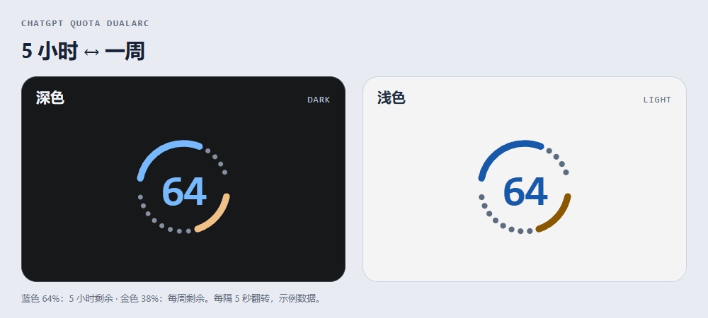
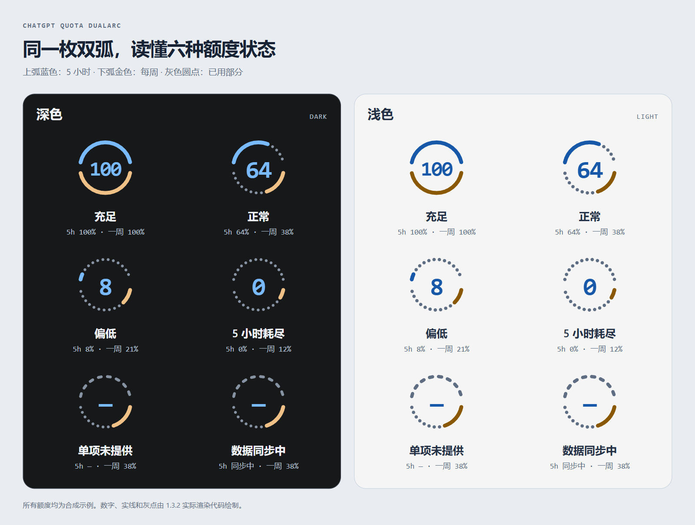

# ChatGPT Quota DualArc

**一枚双弧，同时看清 5 小时与每周额度。**

Windows 桌面应用的非官方本地界面定制，版本 1.3.2。蓝色上弧表示 5 小时剩余额度，金色下弧表示每周剩余额度，灰色圆点表示已用部分。中心数字每隔 5 秒在两组额度之间翻转，悬停可查看百分比及重置时间。



GIF 由实际渲染代码在隔离浏览器中生成。展示数据均为合成示例，不含真实账户或订阅资料；悬停、键盘聚焦及打开详情时会暂停翻转，系统减少动态效果设置也会被尊重。

## 不同额度状态



| 示例状态 | 5 小时剩余 | 每周剩余 | 显示方式 |
| --- | --- | --- | --- |
| 充足 | 100% | 100% | 两条完整实线弧 |
| 正常 | 64% | 38% | 实线弧与灰色已用圆点 |
| 偏低 | 8% | 21% | 实线弧缩短；详情提示偏低 |
| 5 小时耗尽 | 0% | 12% | 上弧全为灰点；详情提示已用尽 |
| 单项未提供 | 未知 | 38% | 缺失项显示破折号及虚线，不按 0% 处理 |
| 数据同步中 | 待同步 | 38% | 冲突项暂不显示百分比，详情提示同步中 |

主题随应用设置自动调整。需要离线查看示例动画时，可打开 [`docs/theme-comparison.html`](docs/theme-comparison.html)。

## 适用范围

- Windows；已安装 Python，开发验证环境为 Python 3.12。
- 启动器当前通过 Microsoft Store 包标识 `OpenAI.Codex` 查找其中的 `app/ChatGPT.exe`。已验证安装包版本为 `26.1029.7803.0`。
- 其他安装包标识、其他发行渠道和其他操作系统未验证。名称中的 ChatGPT 不代表适配所有 ChatGPT 桌面应用。
- 使用应用自身已登录的账户，无需 API Key，不要求填写密码或 Token。
- 非官方项目；使用私有界面结构和调试管道，应用更新可能导致适配失效。这里没有捆绑官方应用或官方图标。

## 安装与使用

1. 将源码解压到准备长期保留的目录。生成快捷方式后移动目录会使快捷方式失效。
2. 在该目录打开 PowerShell，运行：

   ```powershell
   powershell.exe -NoProfile -File ".\安装快捷方式.ps1"
   ```

   脚本使用本机已有的 Python，在桌面及本目录创建启动入口，在本目录创建恢复入口。若能找到本机已安装应用的图标，会复制到本地使用；不下载软件、不安装 Python 或其他依赖。脚本遇到不属于本项目的同名快捷方式会停止。

3. 等当前任务结束后正常退出应用，再从“ChatGPT 额度双弧”启动。脚本不会为了接入而强制关闭已有会话。
4. 恢复原界面时运行本目录的“恢复原圆环”，或：

   ```powershell
   pythonw.exe .\quota_launcher.py --stop
   ```

   此操作撤销界面定制并断开辅助连接。要结束本次调试启动方式，等任务结束后正常退出应用，再从官方入口重开。

如果系统策略阻止 PowerShell 脚本，请遵循本机管理策略。也可通过已安装的 Python 直接运行 `quota_launcher.py`，不需要安装快捷方式。

## 数据与隐私

- 原生额度按钮可用时，只读取该按钮的额度说明及相关 React 祖先中的额度窗口字段。
- 原生按钮缺失时，通过应用内置的 `account/rateLimits/read` 通道读取官方额度。代码在内存中读取当前账户 ID、访问资格和响应账户 ID，以校验额度属于当前账户；不将这些 ID 写入文件。
- 补充读取通常间隔 60 秒，旧数据最多保留 2 分钟。切换账户、账户不匹配或数据失效时会清除旧值。
- 官方响应可能包含本工具未使用的其他字段；本工具只映射两组窗口的已用比例、窗口长度和重置时间，不保存完整响应，不查询账单或支付资料。
- 当前代码未读取凭证文件、浏览器 Cookie 或聊天正文，也未按密钥名称查找或输出 API Key。启动子进程时按常规继承环境变量；父进程环境中已有的敏感变量也可能被子进程继承，发布包本身不包含这些运行时值。
- 没有第三方上传、遥测、更新检查或直接 HTTP 请求逻辑。通过官方应用读取额度时，应用自身可能访问其官方服务；不能将此理解为应用完全离线。
- `state/` 由启动器自动生成，记录时间、运行状态、应用包版本和额度控件的布局诊断。当前诊断不写入账户 ID、额度数值、订阅明细或聊天内容。整个目录均不属于发布内容。

## 安全边界

采用匿名继承管道连接新启动的应用，本启动器不开放 TCP 调试端口。不修改官方安装包、不添加计划任务或系统服务。

调试连接具备执行页面脚本的能力，操作系统并没有将其权限限制为“只能读额度”。`dual-arc.js` 支持本地热更新，因此只能使用可信代码，并保护程序目录的写入权限。本次源码审查未发现凭证外传逻辑，不构成对所有环境和未来版本的安全保证。

导航兜底仅在原有访问资格有效、官方导航配置为空时临时补充显示选择；有明确官方配置时交回官方控制。不调用额度重置、充值或模型生成接口。

## 发布检查

公开仓库只使用此目录中的源码和示例。快捷方式和图标应在使用者本机生成，不要上传运行目录、登录配置、状态文件或旧安装包。

在未运行程序的干净发布副本中执行：

```powershell
python .\tools\check_release.py
```

检查器使用固定文件清单、常见凭证及个人路径模式，并核对预览 PNG 和 GIF 不含文本、EXIF、评论等额外元数据；失败时只显示类型和相对位置，不显示命中的值。它检查目录中实际存在的文件，不只检查 Git 暂存区，也不能证明任意格式的隐私或秘密均不存在。

提交前核对 `git diff --cached`。`.gitignore` 只用于防止后续误收录，不能清除已经提交的内容或历史。还可在 GitHub 使用可用的 secret scanning 和 push protection；它们不能代替本地检查。

Git 提交的作者名和邮箱属于另一层公开信息，不由源码扫描决定。需要邮箱隐私时，使用 GitHub 提供的 `noreply` 提交邮箱，并在首次提交前核对仓库使用的作者资料。

## 许可

尚未指定开源许可证。仓库维护者应在正式开放协作或分发前确定许可并添加 `LICENSE`；本发布副本没有代替维护者选择许可证，也未将官方应用或官方图标纳入分发。
